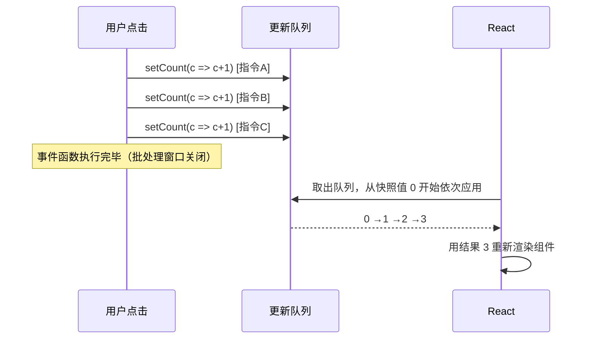

# 2.1 useState 深入：快照语义与批量更新

## 讲解原文

> 承接 1.3 的「快递模型」：传值 = 寄定格成品，传函数 = 寄指令单接流水线最新值。本节把这个模型拆到底层，并补上「批量更新」这半边。

### 一、快照语义的根源：一次渲染 = 一次函数调用 = 一份闭包

React 函数组件的本质你已经很熟了（1.2）：**组件就是函数，渲染就是调用**。那么：

```tsx
function Counter() {
  const [count, setCount] = useState(0)
  console.log(count) // 每次渲染打印什么？
  return <button onClick={() => setCount(count + 1)}>{count}</button>
}
```

点 3 次按钮，`console.log` 依次打印 `0, 1, 2, 3`——即**每次调用产生一个独立的 `count` 变量**，它是 `const`，在整个函数体执行期间**不会变**。

这就是「快照」的根源。它不是 React 做了什么特殊的拷贝，而是一个纯 JS 事实：

```
渲染 #1: 调用 Counter() → useState 返回 0 → count = 0（这份闭包里永远是 0）
渲染 #2: 调用 Counter() → useState 返回 1 → count = 1（新的一份闭包）
渲染 #3: 调用 Counter() → useState 返回 2 → count = 2
```

`useState` 内部做的事：维护一个「与组件位置绑定的存储格」（这就是 hooks 不能写在 if 里的原因——位置即身份）。渲染时从格子取值还给你；`setCount` 时往格子写新值，并**安排一次重新调用**。

### 二、Vue 对照：活引用 vs 定妆照

这是你从 Vue 迁移过来最容易踩的认知差，一张表说清：

| | Vue3 `ref` / `reactive` | React `useState` |
|---|---|---|
| 变量本质 | **活引用**：读 `.value` 时总是最新值 | **值快照**：本次渲染内是常量 |
| 异步回调里读 | 拿到最新值（响应式对象一直在变） | 拿到**那次渲染时**的旧值（闭包捕获） |
| 视图更新 | set 即触发，依赖追踪按属性粒度 | set 后统一调度，整组件函数重新执行 |
| 连续 set | 每次都同步生效 | **批量合并**，一次渲染 |

经典翻车现场（把 Vue 直觉带进 React）：

```tsx
function Counter() {
  const [count, setCount] = useState(0)

  function handleClick() {
    setCount(count + 1)
    setTimeout(() => {
      alert(count) // 点一次弹什么？
    }, 3000)
  }
  return <button onClick={handleClick}>{count}</button>
}
```

在 3 秒内连点 5 次，alert 弹出的是 **0**。因为这份 `handleClick` 属于渲染 #1 的闭包，`count` 在那里永远是 0——**alert 给你看的是那次渲染的定妆照**。Vue 里同样的代码 `alert(count.value)` 会弹 5。

修复方式：`setCount(c => c + 1)` 不解决这个（alert 依然弹旧值）；要读最新值得用函数式更新去取（`setCount(c => { alert(c); return c })` 是 hack），正规姿势是 **useRef**（2.4 讲）或把逻辑移进 set。

### 三、批量更新：一次事件 = 一次渲染

**React 18 起，所有更新自动批处理（automatic batching）**。规则很简单：

> 同一个事件/微任务里发出的所有 setState，会进入更新队列，**合并成一次重渲染**。

```tsx
function Demo() {
  const [a, setA] = useState(0)
  const [b, setB] = useState(0)

  function handleClick() {
    setA(a + 1) // 排队
    setB(b + 1) // 排队
    setA(a + 1) // 再排一条
    // 事件函数跑完 → React 检查队列 → 渲染一次
  }
  return <div>{a} {b}</div> // 点击后显示？
}
```

答案是 `1 1`。因为**整个 `handleClick` 执行期间，`a` 和 `b` 一直是旧值 0**（快照！），三条更新分别是 `a→1, b→1, a→1`，最后一条覆盖前一条。

### 四、更新队列：传值 vs 传函数的真正区别

把 set 想象成往**队列**里放东西：

- `setCount(count + 1)` → 放进去一个**成品值**（此刻就算好了，用的是当前快照的 count）
- `setCount(c => c + 1)` → 放进去一张**指令单**（渲染时 React 拿队列里的最新结果依次执行）

```tsx
function handleClick() {
  setCount(count + 1)  // 成品: 0+1 = 1
  setCount(count + 1)  // 成品: 0+1 = 1（快照还是 0！）
  setCount(count + 1)  // 成品: 0+1 = 1
  // 结果: count = 1 ❌ 三次点击像只点了一次
}

function handleClick2() {
  setCount(c => c + 1)  // 指令: 0→1
  setCount(c => c + 1)  // 指令: 1→2
  setCount(c => c + 1)  // 指令: 2→3
  // 结果: count = 3 ✅
}
```



**什么时候必须用函数式更新**：新值依赖旧值（计数、开关、往数组追加）。**什么时候传值就行**：新值和旧值无关（表单受控 `setForm({...form, name: v})` 里的整对象替换也常传值，但注意展开的 `form` 是快照）。

### 五、Object.is：跳过渲染的最后一道闸

setState 后 React 用 **`Object.is(新值, 旧值)`** 判断，相同则**跳过重渲染**（但可能再跑一次组件函数确认一次，这是 React 的细节行为）。

```tsx
setCount(0) // count 已经是 0 → Object.is(0,0) 为 true → 不渲染
setObj({...obj}) // 内容一样但引用变了 → Object.is 为 false → 照样渲染！
```

对照 Vue：Vue 的 `reactive` 是同对象原地改，判断不了「改没改」就靠依赖追踪；React 是换引用，所以判等天然用 `Object.is`。这也解释了为什么 React 里**永远不要原地修改 state 对象**（`state.items.push(x)`）——引用没变，`Object.is` 判定相等，React 根本不知道要更新（1.3 的 A/B 题你已经踩过）。

### 六、本节心智模型（背下来）

1. **一次渲染一份闭包，state 在其中是 const 快照** —— 异步回调读旧值不是 bug，是闭包的本分
2. **一个事件一批更新，合并成一次渲染**（React 18 全场景自动批处理）
3. **传值 = 成品，传函数 = 指令单** —— 依赖旧值必须传函数
4. **Object.is 判等，相同跳过渲染** —— 所以更新永远要换新引用

## 考核过程

（此段在考核通过后追加填充）
