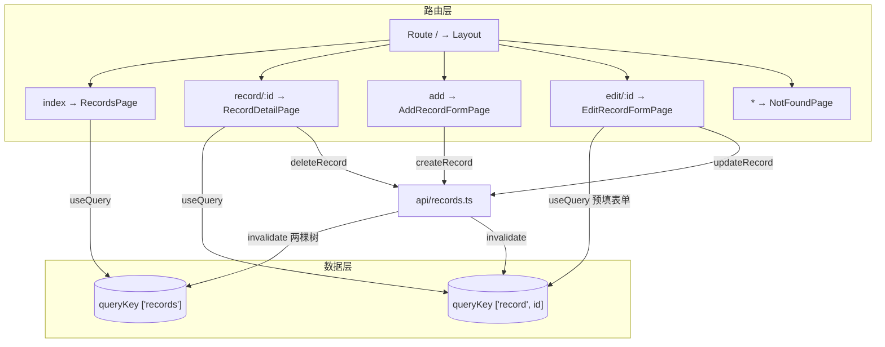

# 记账本 · 里程碑2 路由与详情（4.4-4.6）

> 本文包含 Mermaid 图表，推荐在支持 Mermaid 渲染的 Markdown 阅读器中查看（如 VS Code、Obsidian、Typora）。
> 完成日期：2026-09-21 · 对应节点：react.md 4.4 / 4.5 / 4.6

## 功能说明

从单页应用升级为多页应用，一条账目的完整生命周期闭环：

- **布局路由**：`Layout`（品牌 + NavLink 导航 + `<Outlet/>`）挂在 `path="/"` 父路由，切子路由只换 Outlet 内容，导航常驻
- **详情页** `/record/:id`：`useParams` 拿动态参数 → `useQuery(['record', id])` 单条查询
- **编辑页** `/edit/:id`：复用共享组件 `AddOrEditForm`（`record` prop 区分新增/编辑模式）
- **删除**：详情页 `Dialog.confirm` 确认 → DELETE mutation → `navigate('/', {replace:true})`
- **404 兜底**：catch-all `path="*"` → `NotFoundPage`（放 `"/"` children 最后，保留导航栏）

## 架构图



## 关键代码片段

**1. 两棵缓存树分开失效（本里程碑最重要的纪律）**

```ts
onSuccess: () => {
    // ❌ invalidateQueries({queryKey:['records','record']}) —— 前缀语义下什么都没失效
    queryClient.invalidateQueries({ queryKey: ['records'] })        // 列表树
    queryClient.invalidateQueries({ queryKey: ['record', id] })     // 详情树
    // 删除场景则只失效列表树，详情树留给 gcTime 自然回收
}
```

`invalidateQueries` 的参数是**前缀**（目录路径），不是 key 集合——不能把两个 key 并进一个数组。

**2. 异步数据预填表单：Form 只在数据就位后挂载**

```tsx
const { data } = useQuery<RecordItem>({ queryKey: ['record', id], ... })
if (!data) return <SpinLoading/>          // 数据没到：转圈，不渲染 Form
return <AddOrEditForm record={data}/>     // Form 挂载时 initialValues 必然有效
```

antd Form 的 `initialValues` **只在挂载时读一次**，之后改 prop 不回填。提前挂载 = 空表单。

**3. 删除后 replace 跳转**

```ts
navigate('/', { replace: true })  // 顶掉历史栈里的详情页，后退不会掉进已删记录
```

**4. 括号口诀的两面**

```ts
queryFn: () => getRecordById(id!)    // 传"将来再干"的函数 → 不加括号
onClick={handleBack}                 // 传函数，React 点击时调 → 也不加括号
// 括号 = 现在就干；不加括号 = 把"干这件事"交出去等人调
```

## 踩坑与解决

| 坑 | 现象 | 根因 | 修法 |
|----|------|------|------|
| queryFn 传调用结果（第5次） | 全部 data 变 unknown，TS 连环报错 | `getRecordById(id)` 渲染期就执行，queryFn 拿到 Promise | `queryFn: () => getRecordById(id!)` |
| onClick={()=>handleBack} | 返回按钮点了没反应 | 箭头体是函数本身，从不执行 | `onClick={handleBack}` |
| if(!!params.id) 条件反了 | 详情页只剩返回按钮 | 双重否定写反 | `if(!params.id)` |
| No routes matched "/record/" | 白屏 + 控制台告警 | **路由匹配在组件之前**，`:id` 需非空段，`/record/` 匹配不到任何路由 → Routes 渲染 null，组件内守卫没机会跑 | catch-all `path="*"` 404 页 |
| invalidate key 合并写 | 编辑后列表/详情不更新 | 前缀 ≠ 集合 | 拆成两次 invalidate |
| 删除后列表还显示旧数据 | 30s 内已删条目还在 | invalidate 被注释 + staleTime 内不 refetch | 恢复失效语句 |
| 编辑表单空（被缓存掩护） | 从详情进编辑正常、硬刷新空白 | Form 先挂载、数据后到，initialValues 不回填；详情页缓存让 data 首渲染同步可用，掩盖了坑 | `if(!data)` 早退，Form 延迟挂载 |

## 技术知识点清单

- 布局路由：父 Route element + `<Outlet/>` + index 子路由；父组件不卸载，只换 Outlet 内容
- `NavLink` 激活态：函数式 `className({isActive})`；**段边界匹配**（源码级：`to="/"` 只精确命中，靠的不是隐式 end 而是 `charAt(endSlashPosition)==='/'` 检查）
- `useParams`：动态段永远是 string；`enabled: !!id` 守卫 + `id!` 断言成对出现
- queryKey 层级结构 = 缓存目录树；前缀失效；`['records']` 与 `['record', id]` 是两棵独立树
- `staleTime` 管"新不新鲜"（过期≠删除，stale-while-revalidate 先渲旧再后台刷新）；`gcTime` 管"还在不在"
- `Dialog.confirm` promise 风格确认交互
- antd Form `initialValues` 挂载时机 + 条件渲染/早退式修法
- 共享组件模式：`record?` prop 区分模式 + 数据转换器函数（`recordToFormState`）
- catch-all 路由与两层兜底：路由层（404 页）vs 数据层（组件内 error UI）
- 路由匹配流水线：URL → matchRoutes → 渲染组件，组件代码在最后一环

## 遗留（后续节点处理）

- `NotFoundPage` 仍是裸文案，升级 ErrorBlock + 回首页
- `Number('')` → 0 可静默入库（4.6 编辑校验时一起收）
- `initialData` 缓存播种（详情页方案 B）可作为体验优化后补
- chunk > 500kB 警告：4.11 性能收尾时用 lazy + Suspense 处理
