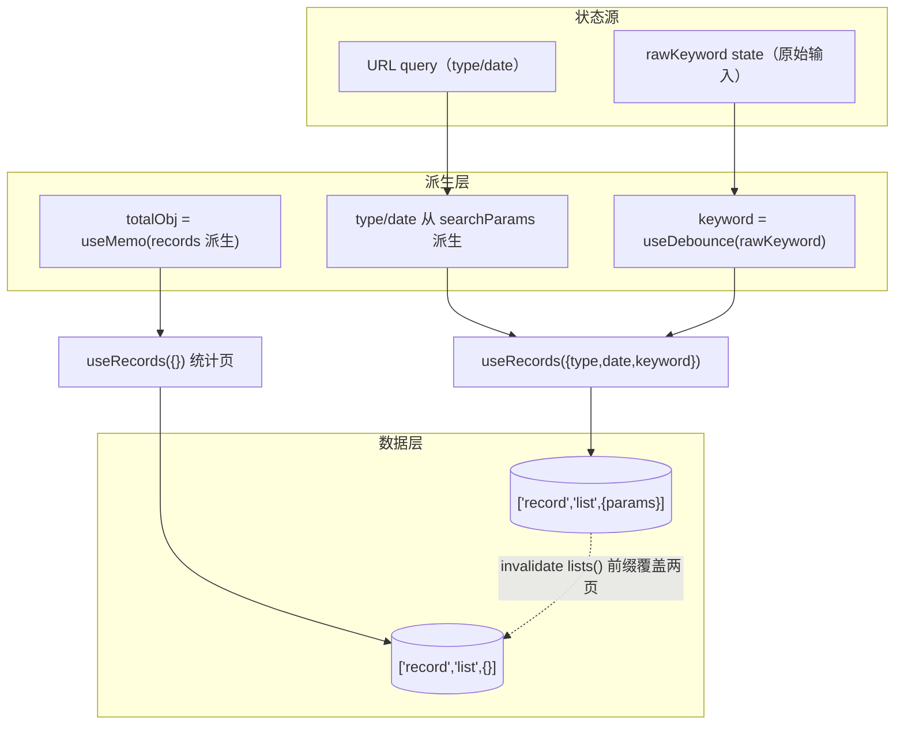

# 记账本 · 里程碑3 筛选与统计（4.7-4.9）

> 本文包含 Mermaid 图表，推荐在支持 Mermaid 渲染的 Markdown 阅读器中查看（如 VS Code、Obsidian、Typora）。
> 完成日期：2026-11-18 · 对应节点：react.md 4.7 / 4.8 / 4.9

## 功能说明

列表页从"全量展示"升级为可查询、可分析的数据视图：

- **筛选（4.7）**：类型（Segmented）+ 月份（DatePicker）筛选，状态全部持久化在 **URL query**（`?type=expense&date=2026-11`），刷新/分享不丢
- **搜索（4.8）**：SearchBar + 自研 `useDebounce`（泛型 Hook），防抖值进 queryKey，`?q=` 全文搜索，与筛选叠加
- **统计页（4.9）**：`/stats` 路由，收入/支出/结余三数 + 支出分类汇总（降序），**纯派生计算零第二数据源**
- **queryKey 工厂**：`queryKeys.ts` 统一管理（`all/lists/list(params)/details/detail(id)`），本里程碑自发重构，TanStack 官方推荐写法

## 架构图



## 关键代码片段

**1. URL 是唯一真相源（4.7 最重要的纪律）**

```tsx
// ❌ 双状态源：useState 存选中月 + URL 也存 → 硬刷新脱节
// ✅ 只留 URL，state 全部派生：
const date = searchParams.get('date')            // 读：只读快照
setSearchParams(prev => {                        // 写：必须走 setSearchParams
    const next = new URLSearchParams(prev)       // 函数式展开，别整体替换
    next.set('date', dayjs(v).format('YYYY-MM'))
    return next
})
```

**2. 防抖 Hook + 防抖值进 queryKey（4.8 核心）**

```ts
export function useDebounce<T>(value: T, delay = 300): T {
  const [debounced, setDebounced] = useState(value)
  useEffect(() => {
    const handler = setTimeout(() => setDebounced(value), delay)
    return () => clearTimeout(handler)   // value 每变都掐掉上个定时器
  }, [value, delay])
  return debounced
}
```

```
输入: a → ab → abc    每键 cleanup 清旧定时器
      停手 500ms → 最后一个定时器活下来 → keyword 才变 → 新 key → 一次请求
```

原始输入进 key = 每键新 key 新请求 + 每个中间串留一条垃圾缓存；防抖值进 key 双杀。

**3. placeholderData：换 key 借旧数据，列表不闪**

```ts
useQuery({
  queryKey: recordKeys.list(params),
  queryFn: () => getRecords(params),
  placeholderData: (prev) => prev   // 新 key 立即 success（借上個 key 的数据）
})
```

**4. Hook 返回回调（Rules of Hooks 实战）**

```ts
// ✅ hook 顶层拿 client，返回普通函数
export function useInvalidateRecordLists() {
  const queryClient = useQueryClient()
  return () => queryClient.invalidateQueries({ queryKey: recordKeys.lists() })
}
// 组件顶层调用 hook；onClick 里只调普通函数
const invalidateLists = useInvalidateRecordLists()
onClick={() => invalidateLists()}
```

**5. 空值参数条件 spread（api 层方言转换）**

```ts
params: {
  type: params.type,
  date_contains: params.date,
  ...(params.keyword ? { q: params.keyword.trim() } : {})  // 空串不过滤
}
```

**6. 派生统计（4.9）**

```tsx
const { data: records } = useRecords({})   // 全量，无筛选
const totalObj = useMemo(() => {
  const acc = (records ?? []).reduce((sum, item) => { /* income/expense 累加 */ }, { income: 0, expense: 0 })
  const map = new Map<string, number>()
  ;(records ?? []).forEach(item => { /* 支出按 category 分组累加 */ })
  const byCategory = [...map.entries()].map(([category, amount]) => ({ category, amount }))
    .sort((a, b) => b.amount - a.amount)
  return { income, expense, balance, byCategory }
}, [records])
// 零 setStats、零第二 state——mutation invalidate lists() 前缀自动波及本页
```

## 踩坑与解决

| 坑 | 现象 | 根因 | 修法 |
|----|------|------|------|
| selectDate useState 与 URL 双状态源 | 硬刷新按钮文案与数据脱节 | 违反"URL 是唯一真相源" | 删 state，从 searchParams 派生 |
| `searchParams.delete()` 不生效 | 点 ✕ 月份没被清掉 | searchParams 是**只读快照**，原地改无效 | 读写分离：写必须走 setSearchParams |
| FilterRender 定义在组件内部 | 每次渲染重挂子树 | 组件边界在函数体内每轮重建 | 改 JSX 变量消除组件边界 |
| 搜索后输入框文字消失、✕ 没了 | 触发查询瞬间搜索框清空 | isLoading 早退**卸载**了非受控 SearchBar（内部 state 随实例销毁；rawKeyword 其实没丢） | 受控 `value={rawKeyword}` + `placeholderData` |
| onClick 里调 Hook | Rules of Hooks 违规（改名前就潜伏） | Hook 只能顶层同步调用 | hook 返回回调、顶层调用 |
| `key={index}` | 分类列表增删复用错位（1.4 老坑回潮） | index 跟位置不跟内容 | `key={item.category}` |
| `.map()` 做副作用 | 丢弃返回值，语义误导 | map 是"转换收集"，副作用该用 forEach | 改 `.forEach` |

## 技术知识点清单

- `useSearchParams`：读写分离（读快照 / 写 setSearchParams）、函数式展开 prev、URL = 可分享的筛选状态
- queryKey 工厂模式（all/lists/list/details/detail）+ 前缀失效跨页面自动波及
- 防抖 Hook：effect + cleanup 清定时器时间线模型；泛型 `<T>` 透传无需 extends
- 受控 vs 非受控的卸载语义：非受控内部 state 随实例销毁，受控从 props 恢复（1.5 概念实战）
- `placeholderData: prev => prev`：换 key 借旧数据，isLoading 不闪；首次加载无旧数据可借才会 loading
- Rules of Hooks：`use` 前缀是 lint 追踪依据；hook 返回回调是标准解法
- 派生不存储：单一数据源哲学（与 URL 唯一真相源同源）
- useMemo 两个正当用途的判断链：计算昂贵？有引用消费者？都不占就可摘
- 条件 spread 过滤空参数；json-server v1 `?q=` 全文 / `?date_contains=YYYY-MM` 月份匹配（自创方言优于区间方案）

## 遗留（后续节点处理）

- `NotFoundPage` 升级 ErrorBlock + 回首页（m2 遗留，未处理）
- chunk > 500kB 警告 → 4.11 性能收尾（lazy + Suspense）
- 搜索词不进 URL：刷新丢搜索词（设计取舍，URL 化会引入防抖时序问题，暂搁）
- 4.10 mock 登录（Context + localStorage + RequireAuth）→ 里程碑4
