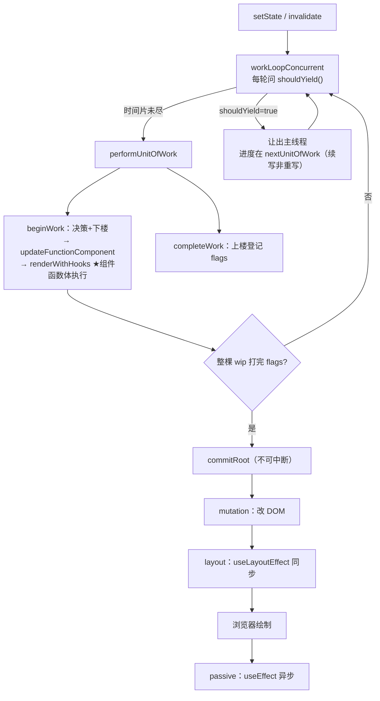

# React 源码原理 · 主题块 A：Fiber 架构 总结

> 完成日期：2026-11-24 · 记录：records/react-source.md · 讲解+考核：raw-document/topic37-react-fiber.md
> 深度：conceptual（面试高频导向，类比驱动）

## 机制总结图（端到端）



```
一句话流水线：loop（问要不要停）→ unitOfWork（begin 下楼 / complete 上楼）
            → commit（mutation/layout/passive 三连，不打断）
```

## 源码地图（React@19，行号随版本浮动认函数名）

| 机制 | 文件 | 函数 |
|------|------|------|
| 主循环/中断判断 | ReactFiberWorkLoop.js | workLoopConcurrent · shouldYieldToHost |
| 节点遍历交替 | ReactFiberBeginWork.js | performUnitOfWork · beginWork |
| 函数组件执行 ★ | ReactFiberBeginWork.js | updateFunctionComponent → renderWithHooks |
| 收尾登记 | ReactFiberCompleteWork.js | completeWork |
| 树交换/提交 | ReactFiberWorkLoop.js | prepareFreshStack · commitRoot |
| 提交子阶段 | ReactFiberCommitWork/CommitEffects.js | commitMutationEffects / commitLayoutEffects / flushPassiveEffects |
| reconcile 复用判定 | ReactChildFiber.js | reconcileChildFibers（位置+key） |

## 设计模式归纳

1. **协作式调度**（cooperative scheduling）：把"抢占"拆成"主动询问"（shouldYield），单线程语言实现可中断的通用手法
2. **双缓冲**（double buffering）：草稿树随便中断，正本树永不被污染——图形学经典方案移植到虚拟 DOM
3. **链表代替栈**（heap 替代 stack）：显式指针保存遍历上下文 = 可序列化、可恢复的执行状态
4. **阶段分离**：纯计算（render，可重跑）与副作用（commit，不可撤销）严格隔离——React 全家桶"组件要纯"纪律的架构级根源

## 跨主题块关联（接口点）

- → **B 块（Hooks 实现）**：`renderWithHooks` 是 Hooks 链表（fiber.memoizedState）被读写的唯一入口——"为什么 Hooks 不能条件调用"的答案就藏在这条调用链里
- → **C 块（调度）**：`shouldYield()` 背后是 Scheduler 的优先级队列与时间切片；lane 优先级决定"谁插队、谁的 wip 被作废重跑"
- ← **使用层回连**：3.1 StrictMode 双调用 / 3.3 effect 竞态 / 4.8 SearchBar 卸载 / 1.4 key 重置子树，全部在本块找到架构级出处

## 考核结果

- T2 双缓存推理 ✅ 一次过 · T3 Vue 对照 ✅ 一次过（金句）
- T1 调用链追踪 ❌→补讲→逃生舱参考通过；函数体执行次数 3次→1次（续写非重写）
- **复习重点**：render 可中断 vs commit 不可中断 · renderWithHooks 位置 · 函数体执行次数语义
