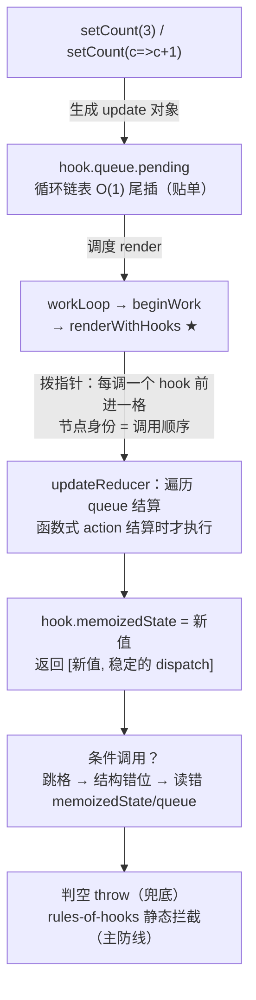

# React 源码原理 · 主题块 B：Hooks 实现 总结

> 完成日期：2026-11-24 · 记录：records/react-source.md · 讲解+考核：raw-document/topic38-react-hooks.md

## 机制总结图（端到端）

**三句话推出全部行为**：
1. 状态在 fiber 链表上（B1）
2. setX 只是贴单，结算在 render（B2）
3. 调用顺序是唯一身份（B3）

## 源码地图（React@19，认函数名不认行号）

| 机制 | 文件 | 函数 |
|------|------|------|
| Hooks 读写总入口 ★ | ReactFiberHooks.js | renderWithHooks |
| mount/update 切换机关 | ReactFiberHooks.js | ReactCurrentDispatcher（两套 dispatcher） |
| 链表推进 | ReactFiberHooks.js | mountWorkInProgressHook / updateWorkInProgressHook |
| useState 底层 | ReactFiberHooks.js | mountState / updateState（→ updateReducer） |
| 队列结算 | ReactFiberHooks.js | processUpdateQueue |
| 错位兜底 | ReactFiberHooks.js | 判空 throw（more/fewer hooks） |

## 设计模式归纳

1. **策略切换**（dispatcher）：mount/update 两套 hook 实现，用全局 Dispatcher 引用一换——同一个 useState 两种生命周期行为
2. **命令队列 + 延迟结算**：setX 生成命令（update）入队，render 时统一结算——天然支持合并、函数式延迟求值、并发重放
3. **环形链表**：pending 指队尾、pending.next 指队头，O(1) 追加 + O(1) 取队头
4. **约定优于配置**：顺序即身份（零参数零冲突），代价是"顶层调用"纪律 + lint 静态分析兜底

## 跨主题块关联（接口点）

- ← **A 块**：renderWithHooks 在 beginWork（updateFunctionComponent）内部被调，函数组件体执行 = Hooks 链表读写窗口；render 可中断/可丢弃重跑 = 队列必须可重放的原因
- → **C 块**：贴单后"调度一次 render"——调度谁、等多久、什么优先级，是 Scheduler/lane 的地界；useTransition 改的正是这个优先级
- ← **使用层回连**：2.1 快照语义 / 1.3 更新丢失 / 2.6 setState 天然稳定 / 2.7 fiber 归属与非单例 / 1.4+3.2 rules-of-hooks（use 前缀），全部在本块找到源码级根因

## 考核结果

- T2（if 调 hook 的隐性风险）✅ 一次过 · T3（放弃 key 方案的代价）✅ 一次过
- T1 取值过程：接近正确 → 提示后补齐"结算"环节 ✅
- **复习重点**：结算环节（updateReducer 遍历 queue）· 顺序=唯一身份 · 自定义 hook 展开占调用者节点
