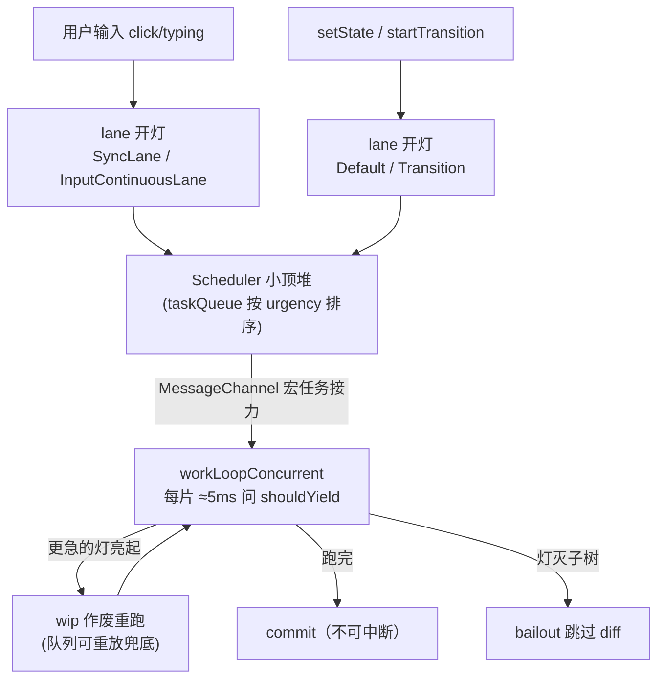

# React 源码原理 · 主题块 C：调度与时间切片 总结（s5 收官）

> 完成日期：2026-11-24 · 记录：records/react-source.md · 讲解+考核：raw-document/topic39-react-scheduler.md
> **s5 全部完成：React 三件套（架构/Hooks/调度）闭环**

## 机制总结图（三块组装的全景）

**并发三件套**：
| 主题块 | 提供 | 对应特性 |
|--------|------|---------|
| A Fiber | 可中断的骨架（堆上指针） | render 分片 |
| B Hooks 队列 | 可重放的账本 | 被打断的更新重新结算 |
| C Scheduler+lane | 谁先谁后的交通规则 | useTransition / 自动批处理 |

## 源码地图（React@19，认函数名）

| 机制 | 文件 | 函数 |
|------|------|------|
| 调度入口 | scheduler/Scheduler.js | scheduleCallback |
| 宏任务接力 | scheduler/Scheduler.js | requestHostCallback（MessageChannel）· performWorkUntilDeadline |
| 让出判断 | scheduler/Scheduler.js | shouldYieldToHost（≈5ms 帧预算） |
| lane 常量/冒泡 | ReactFiberLanes.js | markRootUpdated · getAllLanes |
| 本轮裁决 | ReactFiberWorkLoop.js | getNextLanes |
| bailout 判断 | ReactFiberBeginWork.js | beginWork 内 lanes & renderLanes 检查 |

## 设计模式归纳

1. **宏任务接力**：把"暂停 JS"降级为"排下一条消息"——单线程环境实现协作式时间切片的标准解
2. **位掩码集合**（lane）：一个 int 表达混合待办集合，合并/比较/清除全 O(1)——Linux 权限位同款思路
3. **降级即特性**（useTransition）：不新增更新逻辑，只降优先级档位——用最小 API 表面积组合出并发语义
4. **关注点分层**：ReactFiber 的 lane 与 Scheduler 的 priorityLevel 两套体系中间映射——领域模型与执行引擎解耦

## 跨主题块关联

- ← **A 块**：shouldYield 是 A1 workLoop 的判断开关；"wip 作废重跑"的触发器就是 C2 的插队裁决
- ← **B 块**：队列可重放（B2）是打断重跑能"算得回来"的前提
- ← **使用层回连**：2.1 批量更新 / 3.4 性能优化（bailout 与 memo 的关系）/ 4.11 分包后的输入流畅，均与本块相关

## 考核结果与复习重点

- C 块三题整体逃生舱（参考通过）
- **复习重点**：T1 输入打断 Transition 的链条（橙>绿→作废→先渲染→重放→isPending 语义）；"shouldYield 是响应性开关不是正确性开关"；MessageChannel vs setTimeout/rAF 的致命缺陷

## s5 学习方法沉淀

- 类比锚定（抄书/草稿桌/工位/贴单/灯控面板）→ 机制 → 用使用层考过的题对号（2.1/2.7/3.3/4.8）——"源码解释现象"比"背源码"记得牢
- 面试叙事骨架：**现象（卡顿/快照/跳格）→ 根因（栈/队列/顺序身份）→ 组装（三件套）**
