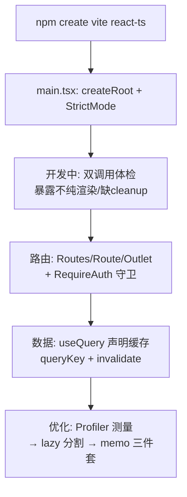

# React 模块 3：工程化 · 阶段总结

> 完成于 2026-09-03。4/4 节点 mastered，考核记录见 raw-document/topic28-31。
> 本文包含 Mermaid 图表，推荐在支持 Mermaid 渲染的 Markdown 阅读器中查看。

## 一、核心知识点清单

| 节点 | 一句话核心 | 蒸馏文件 |
|------|-----------|---------|
| 3.1 Vite+React 结构 | StrictMode 双调用是疫苗：双渲染查纯度、双 effect 查 cleanup，生产无此行为 | topic28 |
| 3.2 React Router | 路由即组件树，Outlet=router-view；守卫是自写的 RequireAuth 组件不是框架设施 | topic29 |
| 3.3 服务端状态 | queryKey 是缓存身份证，声明缓存而非管理请求；失效流优于直写流 | topic30 |
| 3.4 性能优化 | 优化金字塔：测量→状态结构→lazy→虚拟化→memo，顺序即考点 | topic31 |

## 二、工程全流程图（四个节点串起来）

## 三、Vue 对照速查（本模块新增项）

| 能力 | Vue | React |
|------|-----|-------|
| 挂载 | `createApp(App).mount()` | `createRoot(el).render()` |
| 开发体检 | 无（strict 仅 props 警告） | StrictMode 双调用 |
| 路由占位 | `<router-view>` | `<Outlet>` |
| 路由守卫 | `beforeEach`（框架设施） | RequireAuth 组件（自己写） |
| 服务端状态 | vue-query 同门 / 手写模块级 ref 缓存 | TanStack Query |
| 异步组件 | `defineAsyncComponent` | `lazy` + `Suspense` |
| 页面缓存 | `<keep-alive>` 内置 | 无内置（URL query / store / 社区库） |
| 编程式路由 | 全局 `router` 实例 | `useNavigate()`（仅组件内） |

## 四、个性化点评

### 本模块表现

- **场景判断与排序类题目近乎全对**（优化金字塔排序、四场景配对、路由 push/replace 选择）——工程决策直觉好
- **编码题质量明显提升**：RequireAuth 一字不差写出 state.from 记路 + replace 语义；3.3 的 queryKey 一行修正一次到位
- **主动学习行为出现**：主动要求 TanStack Query 详解（补 1-8）、主动提问 StrictMode 时序——问的问题都问在刀刃上

### 遗留错误模式（累计账本，s4 实战盯防）

1. **字符串字面量 vs 变量**：`'userId'`、`key="item.id"`（1.6、3.3 各一次）——写 key/queryKey 时默念"引号里永远不会变"
2. **把调用当传递**：`return clearTimeout(t)`、`onClick={fn()}`（4 次）——"括号=现在就干"
3. **渲染时机预测**：effect 时序、ref 活值（2.3/2.4/3.1）——已固化口诀"渲染读活值，但只有 state/props 变化才触发渲染"
4. **审题漏条件**："未登录"三字漏看（3.2）——预测题先圈题目条件再动笔

### 复习建议

- distilled/topic28-31 四份，重点 3.1 的 StrictMode 时序（你问过的那个问题就是高频面试题）
- React 总进度 **18/22**（s1+s2+s3 完成），下一步 s4 实战项目会把这三个模块全部逼出肌肉记忆

## 五、下一步

**s4 实战项目（project 模式）**：用 React 复刻一个带路由/请求/状态管理的完整应用。启动时会重新拆节点，届时加载 project-mode 工作流。
