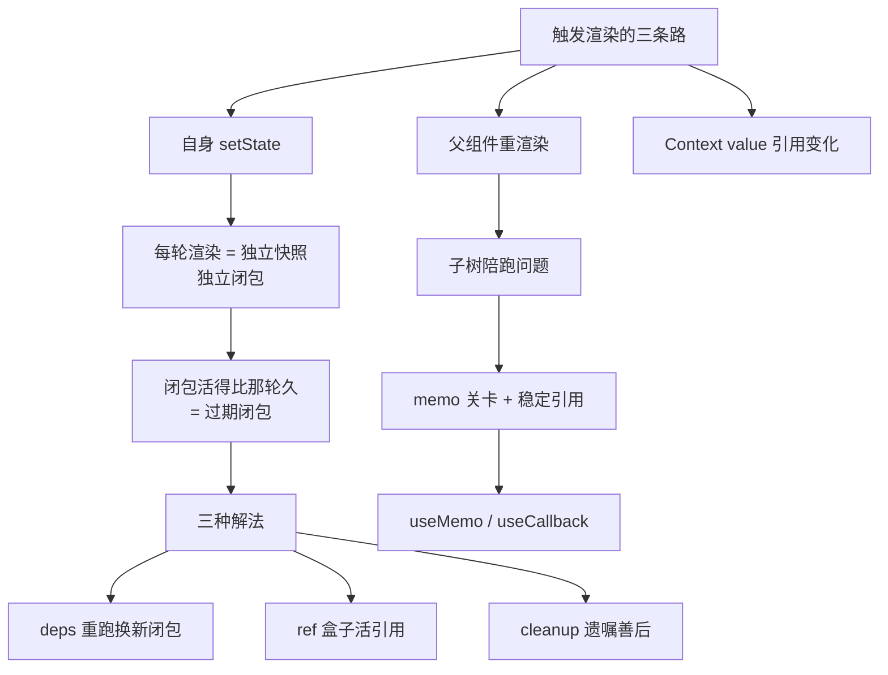

# React 模块 2：Hooks 深入 · 阶段总结

> 完成于 2026-09-01。7/7 节点 mastered，考核记录见 raw-document/topic21-27。
> 本文包含 Mermaid 图表，推荐在支持 Mermaid 渲染的 Markdown 阅读器中查看（如 VS Code、Obsidian、Typora）。

## 一、核心知识点清单

| 节点 | 一句话核心 | 蒸馏文件 |
|------|-----------|---------|
| 2.1 useState 深入 | state 是快照不是引用；多次 set 批量合并 | topic21 |
| 2.2 useEffect | 依赖数组是"重跑合同"；每轮 effect 独立闭包独立变量 | topic22 |
| 2.3 闭包陷阱与 cleanup | 渲染读活值但只有 state/props 变化才触发渲染；cleanup 是本轮 effect 的遗嘱 | topic23 |
| 2.4 useRef | 不触发渲染的活引用盒子 + DOM 把手；React 的逃生舱 | topic24 |
| 2.5 useContext | 广播式更新，价值=变化频率低；解决"传得远"不解决"变得快" | topic25 |
| 2.6 memo 三件套 | memo 逐 prop Object.is 设关卡，useMemo/useCallback 喂稳定引用，缺一环全失效 | topic26 |
| 2.7 自定义 Hook | 零魔法的逻辑复用搬运工；每次调用独立 state 槽位 | topic27 |

## 二、贯穿模块的一条主线（Hooks 世界观）



## 三、关键代码片段（面试默想版）

**1. 竞态处理（2.2/2.3 的 ignore 旗标）**

```tsx
useEffect(() => {
  let ignore = false
  fetch(url).then(json => { if (!ignore) setData(json) })
  return () => { ignore = true }   // 重跑/卸载前作废本轮
}, [url])
```

**2. 防抖 Hook（2.7 综合卷）**

```tsx
function useDebounce(value, delay = 300) {
  const [debounced, setDebounced] = useState(value)
  useEffect(() => {
    const timer = setTimeout(() => setDebounced(value), delay)
    return () => clearTimeout(timer)   // 灵魂：旧定时器连续被掐死
  }, [value])
  return debounced
}
```

**3. 三件套咬合（2.6）**

```tsx
const Child = memo(function Child({ data, onSelect }) { /* ... */ })

// 父组件：
const data = useMemo(() => list.filter(f), [f])        // 稳定值
const onSelect = useCallback((id) => log(id), [])      // 稳定函数
// memo 逐 prop Object.is：全稳 -> 跳过子树渲染
```

## 四、个性化点评

### 易错点汇总（按复发频率排序）

1. **"把调用当传递"× 4**（1.3 / 1.6 / 2.6 / 2.7）：`onClick={fn()}`、`return clearTimeout(t)`、多包一层箭头。口诀：**括号是"现在就干"，不加括号是"到时候再干"**。这是你最高频的编码事故，写 Hook 时先默念一遍
2. **渲染时机预测**（2.3 "0次渲染" / 2.4 "p显示0" / 2.4 Timer 预测）：正解一句话--**渲染读活值，但只有 state/props 变化才触发渲染**。推时间线时先问"这次有没有 setState 真正执行"
3. **deps 判定**（2.6 [todos]）：依赖数组 = 函数体内用到的外部变量；setState 恒定不进，参数不算
4. **memo 击穿者定位**：新数组/新对象只有**直接当 prop** 才击穿；传数组元素时元素引用稳定就过关

### 强项

- 概念辨析一次到位（自定义 Hook 非单例非生命周期、Context 场景选型、派生状态 log.length）
- Vue 对照迁移速度快：composables、provide/inject、computed 的差异都能主动建立映射
- 修正后的二次作答质量高，被指出后能准确自我修复

### 复习建议

- **高价值复习点**：2.3/2.4 的"活值 vs 触发渲染"（你最拧巴的地方，3 天后到期优先过）
- 复习方式：`distilled/topic21-27` 标题 + "解决什么问题" -> 合上默想 -> 卡壳再翻 raw-document
- 编码题策略：先写三行骨架（state / effect / return），再填内容，避免"积木有了但拼装时手滑"

## 五、下一步

s3 工程化（Vite+React 结构 / Router / 数据请求 / 性能清单）已就绪，随时可开。
