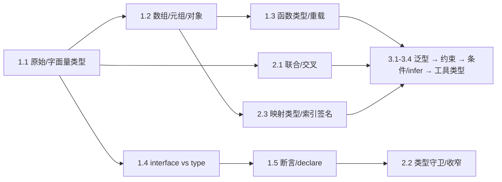
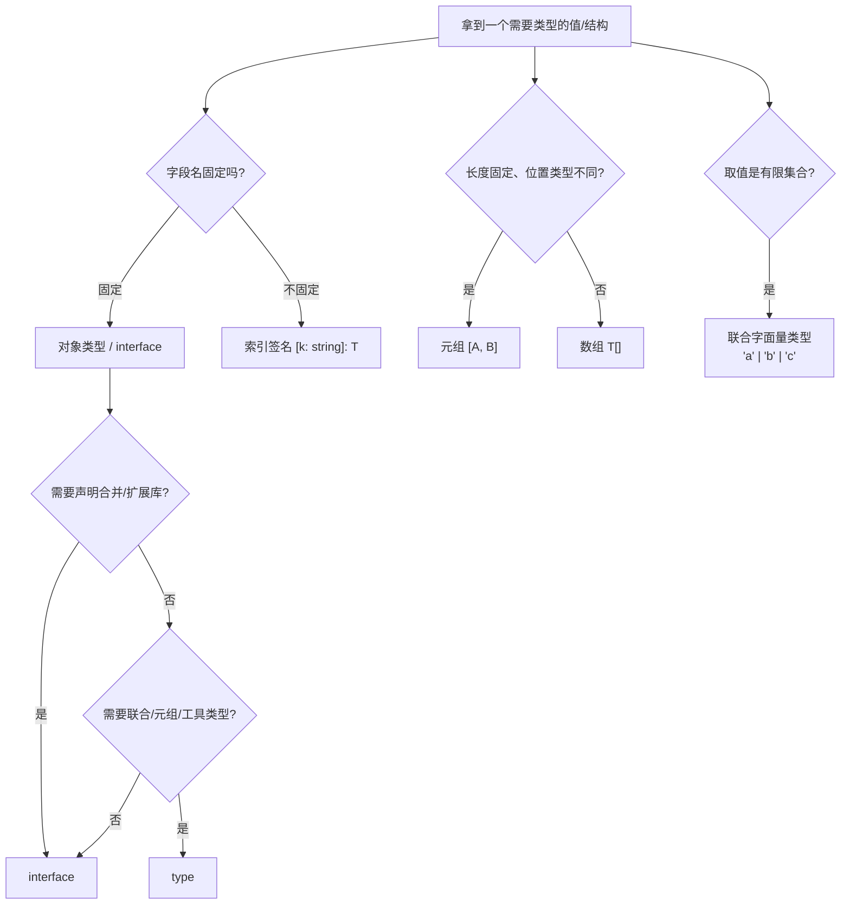

# TypeScript 全主题笔记（topic1-12 合集）

> 覆盖 12 个节点（2026-08-06 ~ 08-10 完成，全部考核通过）：
> 模块一 基础类型系统（topic1-5）· 模块二 进阶类型（topic6-8）· 模块三 泛型与类型体操（topic9-12）
> 合并自 `raw-document/topic1~12` 与 summaries 三份模块总结

## 全景知识地图



字面量类型（1.1）是后面所有「精确类型」的基石：判别联合、重载分派、泛型约束都靠它。

---

# 模块一：基础类型系统

## 1.1 原始类型 & 字面量类型

### 原始类型

TS 的原始类型与 JS 一一对应，共 7 种。类型注解语法 `let 变量名: 类型 = 值`：

```ts
let name: string = 'Tom'
let age: number = 18
let isOn: boolean = true
let nothing: null = null
let undef: undefined = undefined
let sym: symbol = Symbol('id')
let big: bigint = 100n
```

> 类比：类型注解是「变量盒子的标签」。JS 的盒子贴「随便装」，TS 的盒子贴「只准装 number」——装错了编译期就报警。

### 类型推断

大多数时候不必手写注解，TS 根据初值自动推断。**关键陷阱：`let` vs `const` 推断不同：**

```ts
let a = 'hello'    // 推断为 string（宽类型，let 可被重新赋值）
const b = 'hello'  // 推断为 'hello'（字面量类型，const 不可变）
```

### 字面量类型

一个具体的值本身也可以当作类型。单独用没太大用，真正的威力在**联合字面量类型**——表达「有限的取值集合」：

```ts
type Status = 'open' | 'closed' | 'done'
type Role = 'admin' | 'editor' | 'viewer'

function setStatus(s: Status) { /* ... */ }
setStatus('open')    // ✅
setStatus('opened')  // ❌ 拼写错误当场抓到
```

> 类比：`string` 是不限量的自助餐券；字面量联合是「只能从三道菜里选」的套餐菜单——更严格也更精确。

**实战要点**：
1. 替代魔法字符串——拼错 `'don'` 编译期就能抓到，不用等运行时
2. 类型即文档——看到 `Status` 立刻知道业务上有哪些状态
3. `let` 推断会拓宽成宽类型；想要字面量类型就用 `const` 或显式标注 `let s: Status = 'open'`

## 1.2 数组、元组 & 对象类型

### 数组

```ts
let a: number[] = [1, 2, 3]         // 日常用这种
let b: Array<number> = [1, 2, 3]    // 泛型写法，复杂类型时更清晰
```

**联合类型的数组——小心括号（高频坑）：**

```ts
let a: number[]             // 全是 number
let b: number | string[]    // ⚠️ 这是「number 或 string[]」
let c: (number | string)[]  // ✅ 「number 和 string 混合的数组」，必须加括号
```

> `|` 的优先级比 `[]` 低。想表达「数组元素是联合类型」，必须加括号。

### 元组

元组 = **固定长度、每个位置类型可不同**的数组：

```ts
let point: [number, number] = [10, 20]
let httpRes: [number, string] = [200, 'OK']
```

| | 数组 `number[]` | 元组 `[number, string]` |
|---|---|---|
| 长度 | 任意 | 固定 |
| 每个位置类型 | 全部相同 | 可以不同 |

**关键陷阱：字面量数组初值不会推断成元组**。`let t = ['x', 1]` 推断成 `(string|number)[]`，要元组必须显式标注 `let t: [string, number]` 或用 `as const`。

实战场景：`useState` 返回值、CSV 一行、坐标点、`Promise.all` 结果。

### 对象类型

```ts
let user: { name: string; age: number } = { name: 'Tom', age: 18 }
```

**1. 可选字段 `?`**——读取时类型是 `类型 | undefined`，先判空或用可选链：

```ts
type User = { name: string; age?: number }
u.age.toFixed()   // ❌ u.age 可能是 undefined
```

**2. 只读字段 `readonly`**——仅编译期检查，防「代码里误改」，不防运行时篡改。

**3. 索引签名 `[key: 类型]: 类型`**——字段名不固定时用：

```ts
type Scores = { [k: string]: number }
```

**高频坑：索引签名会约束所有字段**——固定字段类型必须兼容索引签名值类型：

```ts
type User = {
  name: string        // ❌ 报错！与 [k: string]: number 不兼容
  [k: string]: number
}
```

> 有具体字段名 → `avatar?: string`；key 不固定 → 才用 `[k: string]: string`。

## 1.3 函数类型（参数/返回值/重载）

### 参数与返回值

```ts
function add(a: number, b: number): number {
  return a + b
}
add(1, '2')   // ❌ 编译报错
add(1)        // ❌ 缺少参数
```

返回值类型通常可推断省略；**对外公开的 API 建议显式标注**，避免实现悄悄改了返回类型没人发现。

### 函数作为类型

```ts
type Formatter = (value: number) => string
const toMoney: Formatter = (n) => '$' + n.toFixed(2)  // 参数 n 自动推断，名字是占位
```

### 可选 / 默认 / 剩余参数

| 特性 | 语法 | 说明 |
|------|------|------|
| 可选参数 | `name?: type` | **必须在必填参数后面** |
| 默认参数 | `name: type = 默认值` | 带默认值后该参数可选 |
| 剩余参数 | `...args: type[]` | 收集剩余实参为数组 |

### void

`void` 表示「调用方不该使用返回值」，常用于回调签名。vs `undefined`：void 允许实现返回任意值，undefined 严格要求返回 undefined。

### 函数重载

问题场景：一个函数根据入参类型返回不同类型的结果，单一签名说不清。解法：**多个重载签名 + 一个实现签名**：

```ts
// 重载签名（对外暴露，可多个）
function query(type: 'list'): string[]
function query(type: 'count'): number
// 实现签名（对外不可见，必须兼容所有重载）
function query(type: string): string[] | number {
  if (type === 'list') return ['a', 'b']
  return 0
}
const r1 = query('list')   // string[]
const r2 = query('count')  // number
```

**三条铁律**：
1. 重载签名在外，实现签名在内（实现签名对外不可见）
2. 实现签名的参数/返回类型必须兼容所有重载（一般是它们的联合）
3. 调用方看到的是重载签名，所以能精确推断返回类型

> TS 的重载不是真的同名多份实现，运行时只有一个函数。重载签名参数类型必须**能区分**（用字面量 `'list'`/`'count'`，不能都用 `string`，否则永远命中第一个签名）。

**为什么不直接联合返回？** 联合返回把类型揉在一起，调用方拿到 `string[] | number` 还得自己收窄，丢掉了「这个入参对应那个返回」的精确对应。

## 1.4 interface vs type

**interface 是「对象形状专用笔」，type 是「万能别名笔」。**

```ts
interface User { name: string; age: number }   // 对象
type Status = 'open' | 'closed'                // 联合 ← interface 做不到
type Pair = [string, number]                   // 元组 ← interface 做不到
type ID = string                               // 基本类型别名 ← interface 做不到
```

### 四个核心差异

1. **声明合并（interface 独有）**：同名 interface 自动合并字段——给第三方库/全局 Window 补字段的唯一方式；type 同名直接报错 `Duplicate identifier`

```ts
interface Window { title: string }
interface Window { status: number }   // ✅ 合并
```

2. **扩展写法**：interface 用 `extends`，type 用 `&`（交叉类型）
3. **type 能表示的类型更多**：联合、元组、基本类型别名只有 type 能做
4. **错误信息**：interface 报错时显示类型名，更友好

> **interface 和 type 共用同一命名空间**，不能互相重名。

### 决策表

| 场景 | 推荐 |
|------|------|
| 描述对象 / 类的形状 | interface |
| 联合 / 元组 / 基本类型别名 | type |
| 需要声明合并 / 扩展库类型 | interface |
| 工具类型 / 映射类型 | type |
| 函数类型 | type 更简洁 |

**口诀：对象形状选 interface，组合别名选 type。团队统一最重要。**

## 1.5 类型断言 & 类型声明

### 类型断言

当 TS 推断的类型和你「知道」的真实类型对不上时，告诉它「相信我」：

```ts
const el = document.getElementById('app') as HTMLDivElement  // 永远用 as（尖括号和 JSX 冲突）
```

**关键认知**：断言**只改类型，不改运行时值**，编译后消失——断言不等于安全：

```ts
const value: any = 'hello'
const num = value as number    // 编译能过
num.toFixed()                  // 运行时炸：num 其实是字符串
```

**断言有约束**：原类型和目标类型必须有重叠；完全不相关要 `as unknown as X` 强制绕过（危险，等于关掉类型保护）。

```ts
const n = 'hi' as number                    // ❌ string 和 number 无重叠
const a = 'hi' as unknown as number         // ✅ 但危险
```

> 断言目标要选「带目标属性的具体子类型」：`querySelector('.search-input') as HTMLInputElement`，不是 `as Element`（Element 没有 `.value`）。

### 类型声明（.d.ts）

import 一个没有类型定义的库时，写 `.d.ts` 声明文件：

```ts
declare module 'old-lib' {
  export function doSomething(x: string): number
}
```

`declare` 的语义：**「运行时已存在，我只告诉你类型，不要生成任何 JS 代码」**——编译产物完全消失。

两类常见用法：

| 类型 | 例子 | 作用 |
|------|------|------|
| 模块声明 | `declare module 'lib' {...}` | 给无类型的第三方库补类型 |
| 全局声明 | `declare const X` / `declare global {...}` | 声明全局变量、扩展内置对象 |

Vue3 项目实战模板：

```ts
// env.d.ts
declare const __APP_VERSION__: string
declare const __DEV__: boolean

declare module '*.vue' {
  import type { DefineComponent } from 'vue'
  const component: DefineComponent<{}, {}, any>
  export default component
}
```

> 注意 `declare interface Window` 用到了声明合并——给全局 Window 安全补属性的方式。

### 断言 vs 类型守卫

| 场景 | 用断言 | 用类型守卫 |
|------|:---:|:---:|
| 100% 确定真实类型，且无法逻辑判断 | ✅ | ❌ |
| 类型可以通过 if/typeof 判断 | ❌（偷懒） | ✅ |
| 运行时数据来源不可信（API/用户输入） | ❌ 危险 | ✅ 必须校验 |

> **断言是「我保证」，类型守卫是「我验证」。能用守卫就别用断言。**

---

# 模块二：进阶类型

## 2.1 联合类型 & 交叉类型

### 核心直觉：或门 vs 与门

| | 联合 `A \| B` | 交叉 `A & B` |
|---|---|---|
| 逻辑关系 | 或（OR） | 与（AND） |
| 值集合 | **并集**（A 或 B 之一） | **交集**（同时具备 A 和 B） |
| 成员可达性 | **交集**（收窄前只能访问公共成员） | **并集**（可访问全部成员） |
| 典型用途 | 多种可能之一 | 组合 / 混入 |

一句话记忆：**联合做「选择」，交叉做「叠加」。**（联合的值是并集、可访问成员是交集；交叉正好相反。）

### 联合类型

```ts
let id: string | number
id = 'abc-123'   // ✅
id = true        // ❌

interface Bird { fly(): void; layEggs(): void }
interface Fish { swim(): void; layEggs(): void }
function operate(pet: Bird | Fish) {
  pet.layEggs()   // ✅ 公共成员
  pet.fly()       // ❌ Fish 没有 fly——收窄前只能碰公共部分
}
```

字面量联合是最常用形态，相当于轻量级枚举：IDE 补全 + 编译期约束 + 收窄后能精确区分分支。

### 交叉类型

```ts
interface Person { name: string; age: number }
interface Loggable { log(): void }
type Employee = Person & Loggable   // 同时有 name, age, log()
```

**本质：属性集合取并集，同名属性类型取交集**——冲突时坍缩成 `never`：

```ts
type A = { name: string; age: number }
type B = { name: number; email: string }
type C = A & B
// name: string & number → never ⚠️ 赋任何值都报错
```

> 联合不是「合并对象」：`{a:1} | {b:2}` 是二选一；`{a:1} & {b:2}` 才等于 `{a:1, b:2}`。

## 2.2 类型守卫 & 类型收窄

### 什么是收窄

编译器沿控制流，根据条件判断把宽类型推导成更精确的子类型：

```ts
function padLeft(value: string, padding: string | number) {
  if (typeof padding === 'number') {
    return ' '.repeat(padding) + value   // padding: number
  }
  return padding + value                 // padding: string
}
```

### 五种收窄手段

| 手段 | 适用场景 | 语法 |
|------|---------|------|
| typeof | 原始类型 | `typeof x === 'string'` |
| in | 对象结构区分 | `'k' in obj` |
| instanceof | 类实例 | `x instanceof Date` |
| 相等性 / switch | 字面量联合、判别联合 | `===` / `switch` |
| 类型谓词 | 复杂自定义判断 | `x is Type` |

```ts
// in：区分对象结构
if ('swim' in pet) { pet.swim() }   // pet: Fish

// instanceof：类实例（对 interface/纯对象无效——运行时类型信息已擦除）
if (x instanceof Date) { x.toISOString() }

// 自定义类型谓词
function isFish(pet: Bird | Fish): pet is Fish {
  return (pet as Fish).swim !== undefined
}
```

### 判别联合（最推荐模式）

多个对象类型共享一个**同名字面量字段**（判别字段），用相等性收窄最稳：

```ts
interface Success { ok: true;  data: string }
interface Failure { ok: false; error: string }
type Result = Success | Failure

function handle(r: Result) {
  if (r.ok === true) { r.data }   // r: Success
  else { r.error }                // r: Failure
}
```

> 判别字段比 `in` 检查业务字段更稳：判别字段专为区分而设计；业务字段可能被两个类型共有导致 `in` 失效（此时 else 分支收窄成 never，编译报错）。

### 穷尽检查 + never

switch 的 `default` 分支赋给 `never`，漏处理任一情况时编译器立刻报错：

```ts
type Status = 'active' | 'inactive' | 'pending'
function handle(s: Status) {
  switch (s) {
    case 'active':   return 1
    case 'inactive': return 0
    case 'pending':  return -1
    default:
      const x: never = s   // 新增字面量却忘加 case，这里报错
      return x
  }
}
```

**易错点**：
1. `typeof null === 'object'`（历史 bug）——判 null 用 `x === null`
2. 真值收窄 `if(r.ok)` 对布尔判别符有效，对字符串/数字字面量判别符无效，须用 `===`/switch
3. 类型谓词的判断逻辑要自己保证正确——TS 只信你的 `is` 声明

## 2.3 映射类型 & 索引签名

### 索引签名

```ts
interface StringMap { [key: string]: string }
const dict: StringMap = { a: '1', b: '2', anything: 'x' }
```

**关键约束：索引签名类型必须兼容所有显式属性**：

```ts
interface Person {
  [key: string]: string
  age: number   // ❌ age 是 number，不兼容
}
```

> number 索引实际会转成字符串（JS 对象键都是字符串），所以 number 索引类型必须是 string 索引类型的子类型。

### keyof

`keyof T` 把 T 的所有键提取成字面量联合——映射类型的基石：

```ts
type UserKeys = keyof User   // 'id' | 'name'
```

```
keyof T            → 获取 T 的所有 key
typeof value       → 获取 value 的类型
T[K]               → 获取 T 中 K 对应的 value 类型（索引访问类型）
K extends keyof T  → K 必须是 T 的合法 key

// 已经是类型 → 直接 keyof
type A = keyof User
// 是变量 → 先 typeof，再 keyof
type B = keyof typeof ROLE
// 变量的属性值类型
type C = typeof ROLE[keyof typeof ROLE]
```

### 映射类型

基于键的联合，遍历每个键生成新类型——「类型层面的循环」：

```ts
type Mapped = { [K in UnionType]: ValueType }

type Stringify<T> = { [K in keyof T]: string }
type R = Stringify<User>   // { id: string; name: string }
```

**修饰符可加减（`+` 可省略，`-` 移除）**：

```ts
type MyPartial<T>  = { [K in keyof T]?: T[K] }          // 全部变可选
type MyReadonly<T> = { readonly [K in keyof T]: T[K] }  // 全部变只读
type Mutable<T>    = { -readonly [K in keyof T]: T[K] } // 移除 readonly
type MyRequired<T> = { [K in keyof T]-?: T[K] }         // 移除可选
```

### 索引签名 vs 映射类型（高频考点）

| | 索引签名 `[key: string]: T` | 映射类型 `[K in keyof T]: ...` |
|---|---|---|
| 键 | 任意 string 键（不固定集合） | 遍历 T 的具体键（固定集合） |
| 用途 | 描述动态键的字典 | 基于已有类型变换生成新类型 |
| 产物 | 「开放」对象 | 「封闭」对象 |

> 映射类型的 `in` 是「类型层遍历键」，不是 2.2 的运行时类型守卫 `in`，别混淆。

---

# 模块三：泛型与类型体操

演进主线：**从「能复用」→「能约束」→「能判断提取」→「现成工具」**。

## 3.1 泛型基础

### 解决什么问题

`any` 能装任何类型，代价是**交还类型保护**——返回值是 any，编译器不再帮你查错。泛型解决这个矛盾：**写一份逻辑，但保留「入参类型 → 返回类型」的精确关系**。

```ts
function identity<T>(value: T): T {
  return value
}
const n = identity<number>(42)   // 显式指定 T = number
const s = identity('hi')         // 推断 T = string
n.toUpperCase()                  // ✅ 现在会报错
```

> `T` 不是「任意类型」，而是「调用那一刻被锁定的某个具体类型」——同一次调用里 T 是同一个类型，这保证了入参和返回的类型关系不被擦除。

### 三种声明形式

```ts
// ① 泛型函数
function first<T>(arr: T[]): T { return arr[0] }

// ② 泛型接口
interface Box<T> { value: T }

// ③ 泛型类
class Stack<T> {
  private items: T[] = []
  push(x: T) { this.items.push(x) }
  pop(): T | undefined { return this.items.pop() }
}
```

### 实战：泛型 API 响应包装

```ts
interface ApiResponse<T> {
  code: number
  message: string
  data: T
}
const userRes: ApiResponse<{ id: number; name: string }> = { code: 200, message: 'ok', data: { id: 1, name: '张三' } }
userRes.data.name   // ✅ 有类型提示，data 不是 any
```

复用结构，不丢类型——封装 axios 时 `request<T>(...)` 返回 `Promise<T>` 的底层原理。

### 命名约定

| 名字 | 含义 |
|------|------|
| `T` (Type) | 第一个泛型类型 |
| `U`、`V` | 第二、第三个 |
| `K` (Key) / `V` (Value) | 对象键 / 值 |
| `E` (Element) | 集合元素 |

> 易错：对象字面量（值）属性间用 `,` 不是 `;`；interface 里 `;`/`,` 都行。

## 3.2 泛型约束（extends）

### 解决什么问题

无约束的 T 上做不了任何有意义操作（`x.length` 报错）。约束给 T 设一个「下限」——T 至少满足某个形状，函数体就能安全访问该形状的成员。

```ts
interface HasLength { length: number }

function getLength<T extends HasLength>(x: T): number {
  return x.length   // ✅ 约束保证 T 一定有 length
}
getLength('abc')      // ✅
getLength(123)        // ❌ number 不满足 HasLength
```

> **extends 在这里是「约束」不是「继承」**，读作「T 至少是 HasLength 形状」。

### 约束保留具体类型

```ts
function getLength<T extends HasLength>(x: T): T { return x }
const s = getLength('abc')   // s: string，不是 HasLength
```

对比直接写 `x: HasLength`（返回值变 HasLength，丢掉具体类型）：**约束让 T 既有最低保证，又保留具体身份**。

### keyof 约束：安全访问对象属性

```ts
function getValue<T extends object, K extends keyof T>(obj: T, key: K): T[K] {
  return obj[key]
}
const user = { name: '张三', age: 18 }
getValue(user, 'name')    // ✅ 返回 string
getValue(user, 'email')   // ❌ 'email' 不是 user 的 key，编译期报错
```

### 其他

```ts
// 多约束：交叉
function logBoth<T extends { id: number } & { name: string }>(x: T) { /* ... */ }

// 默认类型参数
interface Paginated<T = any> { data: T[]; total: number }
```

### 三种写法对比

| 写法 | 函数体能否用 `.length` | 保留具体类型 |
|------|------|------|
| `x: any` | 能（但不安全） | 否 |
| `x: T`（无约束） | 不能 | 是 |
| `x: T extends HasLength` | 能（安全） | 是 |

> extends 相比**无约束泛型**的新增能力：「能用成员」；相比**基类型**的新增能力：「保留具体类型」。别混。

## 3.3 条件类型 & infer

### 条件类型：类型层面的三元

```ts
type IsString<T> = T extends string ? true : false
type A = IsString<'hi'>   // true
```

### 分布性（Distributive）

当 T 是**裸联合**时，条件类型把联合拆开逐个判断再合并：

```ts
IsString<string | number>
  = IsString<string> | IsString<number>
  = true | false
  = boolean
```

想关掉分布性：用方括号包住 `[T] extends [U]`，T 不再是「裸」的：

```ts
type IsStringNonDist<T> = [T] extends [string] ? true : false
type D = IsStringNonDist<string | number>   // false（整体判断）
```

### infer：从类型里「提取」

`infer R` 在 extends 子句里声明待提取的类型变量，匹配成功时把对应部分绑给 R：

```ts
// 提取数组元素类型
type ElementOf<T> = T extends (infer E)[] ? E : never
type R1 = ElementOf<number[]>   // number

// 解包 Promise
type Unwrap<T> = T extends Promise<infer R> ? R : T
type R4 = Unwrap<Promise<string>>   // string
type R5 = Unwrap<number>            // number（原样返回）
```

读法：`T extends Promise<infer R>` = 「如果 T 形如 `Promise<某类型>`，把那个某类型叫作 R」。

### 自造 ReturnType

```ts
type MyReturnType<T> = T extends (...args: any[]) => infer R ? R : never
type MyParameters<T> = T extends (...args: infer P) => any ? P : never
```

> 分布性提醒：`ToArray<string | number>` 拆开后得到 `string[] | number[]`——这是**联合**（满足其一即可），**不等于 `[]`**，不会坍缩。

## 3.4 内置工具类型实战

底层零件 → 工具类型对应：

```
泛型 <T>  ─┐
映射类型   ─┼──→ Partial / Required / Readonly / Pick / Record
keyof     ─┘
条件类型+infer ──→ ReturnType / Parameters
分布性条件类型 ──→ Exclude / Extract
```

### ① 属性修饰类：Partial / Required / Readonly

```ts
type PartialUser  = Partial<User>    // 全字段变可选
type RequiredUser = Required<User>   // 全字段变必填（移除 ?）
type ReadonlyUser = Readonly<User>   // 全字段变只读

// 底层
type MyPartial<T>  = { [K in keyof T]?: T[K] }
type MyReadonly<T> = { readonly [K in keyof T]: T[K] }
```

### ② 字段筛选类：Pick / Omit

```ts
type UserPreview = Pick<User, 'id' | 'name'>   // 只留 id、name
type UserSafe    = Omit<User, 'email'>         // 去掉 email

// 底层
type MyPick<T, K extends keyof T> = { [P in K]: T[P] }
type MyOmit<T, K extends keyof T> = Pick<T, Exclude<keyof T, K>>
```

### ③ 构造类：Record

```ts
type UserMap   = Record<string, User>              // { [k:string]: User }
type StatusMap = Record<'open' | 'closed', string> // key 必须是这两个之一

// 底层：keyof any = string | number | symbol
type MyRecord<K extends keyof any, V> = { [P in K]: V }
```

### ④ 类型提取类：ReturnType / Parameters

```ts
function fetchUser(id: number): User { /* ... */ }
type R = ReturnType<typeof fetchUser>   // User
type P = Parameters<typeof fetchUser>   // [number]
```

### Exclude / Extract（联合操作）

```ts
type T = Exclude<'a' | 'b' | 'c', 'a'>        // 'b' | 'c'  剔除
type U = Extract<'a' | 'b' | 'c', 'a' | 'b'>  // 'a' | 'b'  提取

// 底层是分布性条件类型
type MyExclude<T, U> = T extends U ? never : T
```

### 工具类型速查表

| 类别 | 工具 | 作用 | 底层零件 |
|------|------|------|---------|
| 修饰 | Partial / Required / Readonly | 加/去 ?、加 readonly | 映射类型 |
| 筛选 | Pick / Omit | 留/删指定字段 | 映射 + keyof |
| 构造 | Record | 批量造同 value 的对象 | 映射 + keyof any |
| 提取 | ReturnType / Parameters | 拿函数返回/参数类型 | 条件类型 + infer |
| 联合 | Exclude / Extract | 剔除/提取联合成员 | 分布性条件类型 |

### 实战场景

```ts
// 表单草稿态：Partial（先建空对象、再逐个填字段）
let draft: Partial<Form> = {}
draft.name = '张三'   // 只填一个也合法

// 枚举映射：Record 收束 key（少写一个 key 立刻报错）
const statusText: Record<'open' | 'done' | 'closed', string> = {
  open: '进行中', done: '已完成', closed: '已关闭'
}

// 消除重复：ReturnType 跟着函数走
type User = ReturnType<typeof fetchUser>   // 函数改返回类型，User 自动跟着变
```

---

# 总结与复习

## 类型精确化决策路径



## 高频坑位表（来自考核实战）

| # | 坑 | 正解 |
|---|----|------|
| 1 | `let currentStatus = 'pending'` 后赋拼错的值静默通过 | let 拓宽成 string 保护失效；显式标注 `let s: OrderStatus` 或用 const |
| 2 | `number \| string[]` 想表达混合数组 | `\|` 优先级低于 `[]`，必须写 `(number \| string)[]` |
| 3 | 期望 `['x', 1]` 推断成元组 | 字面量初值只推 `(string\|number)[]`；显式标注 `[string, number]` |
| 4 | 可选字段直接 `.toFixed()` | 可选字段读取时是 `类型 \| undefined`，先判空或用可选链 |
| 5 | `?.` 处理「不显示 undefined」 | 可选链只管访问不报错，不管显示格式；要控制输出用 `if` 条件拼接 |
| 6 | 索引签名旁写不兼容的固定字段 | 索引签名约束所有字段；值类型改成 `string \| number` 或别混用 |
| 7 | 重载签名参数都写成宽类型 `string` | 重载签名必须用能区分的类型（字面量），否则永远命中第一个 |
| 8 | 实现签名返回类型不兼容重载 | 实现签名 = 所有重载的联合，且消除末尾隐式 undefined |
| 9 | interface 和 type 用同一名字 | 二者共用命名空间，`Duplicate identifier` |
| 10 | 断言成 `as Element` 就想访问 `.value` | 断言到「真正带目标属性的具体子类型」`HTMLInputElement` |
| 11 | 对象类型里方法简写与属性式混用 | `m(x): T` 或 `m: (x) => T` 二选一 |
| 12 | `.d.ts` 默认导出写成 `export function` | 分两步：先 `const x: {...}` 声明形状，再 `export default x` |
| 13 | 联合 vs 交叉的成员可达性搞反 | 联合值并集但成员交集；交叉值交集但成员并集 |
| 14 | 交叉同名冲突 `string & number` | 坍缩为 `never`，赋任何值都报错 |
| 15 | `if(r.ok)` 对字符串判别符收窄 | 真值收窄只对布尔判别符有效，字符串/数字用 `===`/switch |
| 16 | 映射类型的 `in` 和守卫的 `in` 混淆 | 映射 `in` 是类型层遍历键；守卫 `in` 是运行时判断属性有无 |
| 17 | `string[] \| number[]` 误坍缩成 `[]` | `\|` 是联合（满足其一），不取交集、不坍缩 |
| 18 | 对象字面量属性用 `;` 分隔 | 对象字面量（值）只能用 `,`；interface 里 `;`/`,` 都行 |

## 核心机制对比总表

| 机制 | 运算符/语法 | 值集合 | 成员可达性 |
|------|------------|--------|-----------|
| 联合 | `A \| B` | 并集（A 或 B） | 交集（公共成员） |
| 交叉 | `A & B` | 交集（A 且 B） | 并集（全部成员） |
| 索引签名 | `[key:string]: T` | 任意键 | 单一值类型 |
| 映射类型 | `[K in keyof T]` | 固定键集合 | 按 T[K] 变换 |

## 复习线索（主题内串联）

1. **字面量类型一条线**：1.1 字面量联合消灭魔法字符串 → 1.3 重载签名用字面量分派 → 1.5 `as 'success' | 'fail'` → 2.2 判别联合 → 3.x `K extends keyof T`
2. **interface vs type 一条线**：1.4 声明合并 → 1.5 `declare interface Window` 扩展全局 → 2.3 映射类型只能用 type 写
3. **信任 vs 验证一条线**：1.5 断言（我保证）→ 2.2 类型守卫（我验证）→ 2.3 索引签名约束
4. **泛型演进一条线**：3.1 类型参数化（能复用）→ 3.2 extends 约束（能限制+保留具体类型）→ 3.3 条件类型+infer（能判断提取）→ 3.4 工具类型（现成轮子）

## 易错点个人清单（考核实测）

1. **审题漏答子问**——把每个问号都标记一下，避免遗漏
2. **「键」和「值」表述要分清**——描述类型时明确区分键的类型和值的类型
3. **extends 的「新增能力」区分**——相比无约束泛型是「能用成员」，相比基类型是「保留具体类型」
