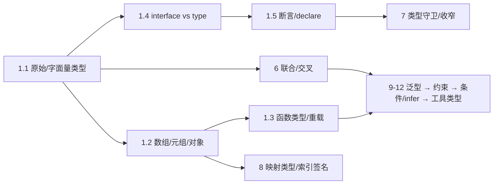
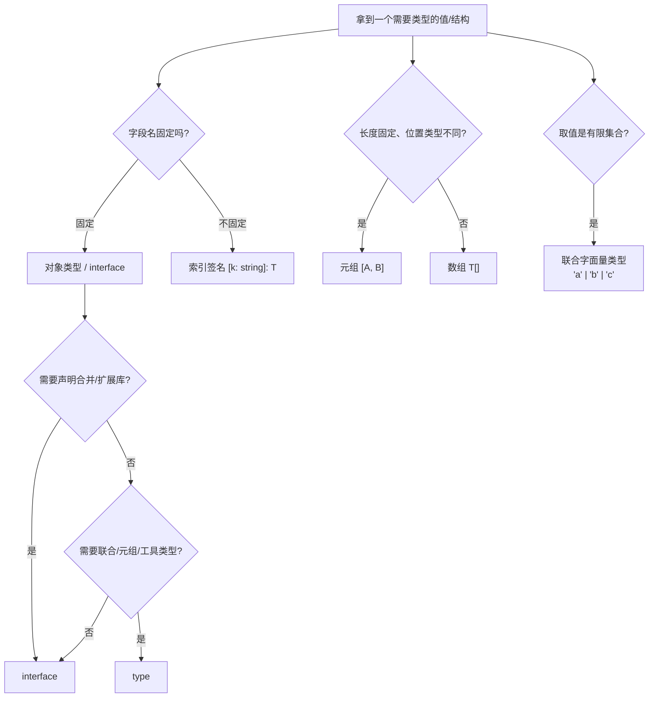

# TypeScript 基础类型系统 · 模块总结

> 覆盖 topic1-topic5（2026-08-06 ~ 08-07 完成，全部考核通过）
> 配套：topic6-8 见 `typescript_advanced-types.md`，topic9-12 见 `typescript_generics.md`

## 模块概览

本模块是 TS 的地基：从「给值贴类型标签」（原始类型/字面量）→「描述结构」（数组/元组/对象）→「描述行为」（函数类型/重载）→「命名类型的两种笔」（interface vs type）→「告诉编译器'相信我'」（断言/declare）。学完后能独立给一个后台管理系统的数据模型和 API 层写完整类型。

## 知识地图（topic1-5 → topic6-12 全景）

字面量类型（1.1）是后面所有「精确类型」的基石：判别联合、重载分派、泛型约束都靠它。

---

## 核心知识点清单

### 1.1 原始类型 & 字面量类型
- 7 种原始类型：string / number / boolean / null / undefined / symbol / bigint；注解语法 `let x: 类型 = 值`
- 类型推断：不写注解 TS 自动猜；**`let` 推宽类型，`const` 推字面量类型**
- 字面量类型：具体的值本身就是类型（`'hello'`、`42`）；单独用没用，**联合字面量才是杀手锏**
- `type Status = 'open' | 'closed' | 'done'` —— 消灭魔法字符串，拼错编译期就抓到，类型即文档

### 1.2 数组、元组 & 对象类型
- 数组：`类型[]` 或 `Array<类型>`；**联合数组必须加括号** `(number | string)[]`（`|` 优先级低于 `[]`）
- 元组 `[string, number]`：固定长度、各位置类型可不同；适用 useState 返回值、CSV 行、坐标
- **字面量数组初值不会推断成元组**：`let t = ['x', 1]` → `(string|number)[]`，要元组必须显式标注
- 对象：`?` 可选（读取时是 `类型 | undefined`）、`readonly` 只读（仅编译期）、`[k: string]: T` 索引签名
- **索引签名会约束所有字段**：固定字段类型必须兼容索引签名值类型，否则报错
- 有具体字段名 → `avatar?: string`；key 不固定 → 才用 `[k: string]: string`

### 1.3 函数类型（参数/返回值/重载）
- 参数 `name: type`，返回值 `): type`；返回值多可推断省略，公开 API 建议显式标
- 函数类型字面量 `type Formatter = (value: number) => string`，箭头里参数名只是占位
- 可选 `?` / 默认 `= 值` / 剩余 `...args: type[]`；**可选参数必须在必填参数之后**
- `void`：调用方不该使用返回值；vs `undefined` —— void 允许实现返回任意值
- **重载** = 多个对外重载签名 + 一个兼容实现签名（实现签名对外不可见）；运行时只有一个函数
- 重载签名参数类型必须**能区分**（用字面量 `'list'` / `'count'`，不能都用 `string`），否则永远命中第一个签名
- 重载 vs 联合返回：重载保留「入参→返回」的精确对应，联合返回把类型揉一起还得收窄

### 1.4 interface vs type
- **interface 是对象形状专用笔，type 是万能别名笔**
- 四个核心差异：
  1. **声明合并**（interface 独有）：同名 interface 自动合并字段 —— 给第三方库/全局 Window 补字段的唯一方式；type 同名直接报错
  2. 扩展写法：interface 用 `extends`，type 用 `&`
  3. type 能表示联合/元组/基本类型别名，interface 只能描述对象形状
  4. interface 报错信息更友好（显示类型名）
- **interface 和 type 共用同一命名空间**，不能互相重名
- 口诀：**对象形状选 interface，组合别名选 type**；团队统一最重要

### 1.5 类型断言 & 类型声明
- 断言 `as`（永远用 as，尖括号和 JSX 冲突）；**只改类型不改运行时值**，编译后消失，断言 ≠ 安全
- 断言约束：原类型和目标类型必须有重叠；完全不相关要 `as unknown as X` 强制绕过（危险，等于关掉类型保护）
- **断言目标选「带目标属性的具体子类型」**：`querySelector('.search-input') as HTMLInputElement`，不是 `as Element`
- `declare`：告诉 TS「运行时已存在，只要类型不要代码」，编译产物完全消失
- `.d.ts` 两类用法：`declare module 'lib'`（给无类型库补类型）、`declare const X` / `declare global`（全局变量/扩展内置对象）
- 经验法则：**断言是"我保证"，类型守卫是"我验证"** —— 能用守卫就别用断言

---

## 关键流程图：类型精确化决策路径

---

## 高频坑位表（来自考核实战）

| # | 坑 | 正解 |
|---|----|------|
| 1 | `let currentStatus = 'pending'` 后赋拼错的值静默通过 | let 拓宽成 string 保护失效；显式标注 `let s: OrderStatus` 或用 const |
| 2 | `number \| string[]` 想表达混合数组 | `\|` 优先级低于 `[]`，必须写 `(number \| string)[]` |
| 3 | 期望 `['x', 1]` 推断成元组 | 字面量初值只推 `(string\|number)[]`；显式标注 `[string, number]` |
| 4 | 可选字段直接 `.toFixed()` | 可选字段读取时是 `类型 \| undefined`，先判空或用可选链 |
| 5 | `?.` 处理「不显示 undefined」 | 可选链只管访问不报错，不管显示格式；要控制输出用 `if` 条件拼接 |
| 6 | 索引签名旁写不兼容的固定字段 | 索引签名约束所有字段；值类型改成 `string \| number` 或别混用 |
| 7 | 重载签名参数都写成宽类型 `string` | 重载签名必须用能区分的类型（字面量），否则永远命中第一个 |
| 8 | 实现签名返回类型不兼容重载 | 实现签名 = 所有重载的联合，且消除末尾隐式 undefined |
| 9 | interface 和 type 用同一名字 | 二者共用命名空间，`Duplicate identifier` |
| 10 | 断言成 `as Element` 就想访问 `.value` | 断言到「真正带目标属性的具体子类型」`HTMLInputElement` |
| 11 | 对象类型里方法简写与属性式混用 | `m(x): T` 或 `m: (x) => T` 二选一 |
| 12 | `.d.ts` 默认导出写成 `export function` | 分两步：先 `const x: {...}` 声明形状，再 `export default x` |

---

## 模块内串联（复习线索）

1. **字面量类型一条线**：1.1 字面量联合消灭魔法字符串 → 1.3 重载签名用字面量分派 → 1.5 `as 'success' | 'fail'` → 2.2 判别联合 → 3.x `K extends keyof T`
2. **interface vs type 一条线**：1.4 声明合并 → 1.5 `declare interface Window` 扩展全局 → 8 映射类型只能用 type 写
3. **信任 vs 验证一条线**：1.5 断言（我保证）→ 2.2 类型守卫（我验证）→ 2.3 索引签名约束
